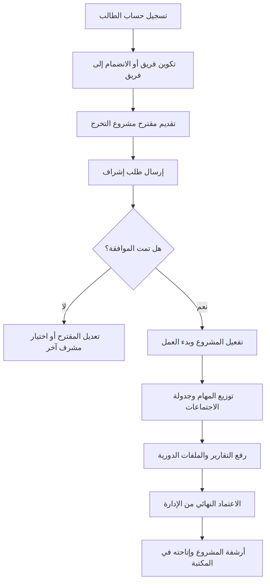
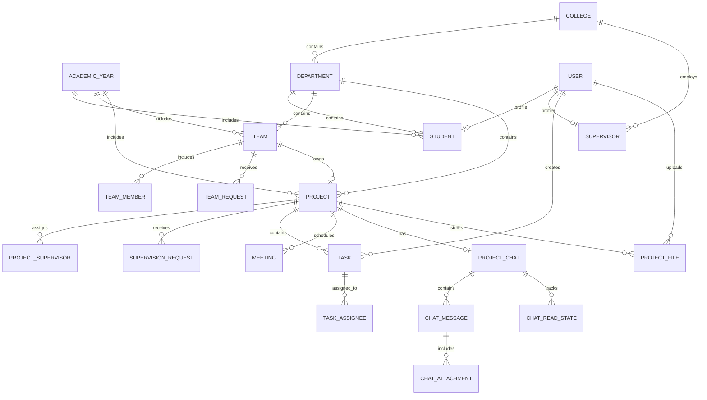

# 🎓 نظام إدارة مشاريع التخرج (GPMS)

منصة متكاملة لأتمتة وتنظيم مشاريع التخرج في الكليات والجامعات. يجمع **GPMS** الطلاب
والمشرفين الأكاديميين وإدارة الكلية في منظومة واحدة لتقديم المشاريع، متابعة التقدم،
إدارة المهام والملفات، وتوثيق الاجتماعات والمحادثات.

---

## 🔍 نظرة عامة

يتكون النظام من ثلاثة أجزاء مترابطة:

| الجزء | المسؤولية |
| --- | --- |
| **لوحة الإدارة** | إدارة الكليات والأقسام والسنوات والمشاريع والمشرفين والصلاحيات والتقارير. |
| **تطبيق الجوال** | تمكين الطلاب والمشرفين من متابعة المهام والاجتماعات والملفات والمحادثات. |
| **واجهة REST API** | نقل البيانات بأمان بين التطبيق والخادم باستخدام Laravel Sanctum. |

---

## 📌 الفهرس

- [الميزات الأساسية لكل دور](#-الميزات-الأساسية-لكل-دور)
- [البنية التقنية](#-البنية-التقنية)
- [مخططات النظام](#-مخططات-النظام)
- [الترخيص](#-الترخيص)

---

## 🌟 الميزات الأساسية لكل دور

### 👤 الطالب (قائد وعضو الفريق)

- **إدارة الفرق:** إنشاء فريق أو طلب الانضمام إلى فريق قائم واستقبال الدعوات.
- **تقديم المشاريع:** إرسال مقترح المشروع وطلب الإشراف من الأكاديميين المتاحين.
- **إدارة المهام:** متابعة المهام المسندة وتحديث حالتها حتى الإنجاز.
- **رفع التقارير:** رفع ملفات المشروع وحفظ إصداراتها وتحديد النسخة النهائية.
- **التواصل اللحظي:** الدردشة داخل المشروع مع مشاركة المرفقات واستقبال الإشعارات.
- **مكتبة المشاريع:** البحث في أرشيف مشاريع التخرج السابقة.

### 👨‍🏫 المشرف الأكاديمي

- **طلبات الإشراف:** مراجعة الطلبات وقبولها أو رفضها مع توضيح السبب.
- **متابعة المشاريع:** مراقبة تقدم المشاريع والمهام الخاصة بها.
- **جدولة الاجتماعات:** إنشاء الاجتماعات وتحديد وقتها ومكانها أو رابطها الإلكتروني.
- **الدردشة والمهام:** التواصل مع الفرق وإسناد مهام الطلاب وتحديثها.

### 🛡️ إدارة الجامعة والكليات (الأدمن)

- **التهيئة الأساسية:** إدارة الكليات والأقسام والقيود الأكاديمية للفرق.
- **إدارة السنوات:** تفعيل السنوات الدراسية وأرشفة المشاريع السابقة عند انتهائها.
- **التقارير والإحصائيات:** عرض معدلات الإنجاز وتوزيع نصاب المشرفين والطلاب.
- **التحكم بالصلاحيات:** إدارة الأدوار والصلاحيات باستخدام Spatie وFilament Shield.

---

## 💻 البنية التقنية

### الخلفية ولوحة التحكم (Backend & Admin Panel)

- **الإطار الأساسي:** [Laravel 12.x](https://laravel.com) مع PHP 8.2 أو أحدث.
- **لوحة التحكم:** [Filament v5](https://filamentphp.com) المبنية على Livewire v4.
- **المصادقة:** [Laravel Sanctum](https://laravel.com/docs/12.x/sanctum) لتأمين واجهات API.
- **الصلاحيات:** [Spatie Laravel Permission](https://spatie.be/docs/laravel-permission) و[Filament Shield](https://github.com/bezhanSalleh/filament-shield).
- **البث اللحظي:** [Laravel Reverb](https://laravel.com/docs/12.x/reverb) أو Pusher Channels.

### تطبيق الجوال (Mobile Frontend)

- **إطار العمل:** [Flutter](https://flutter.dev) المتوافق مع SDK `^3.38`.
- **إدارة الحالة:** [Riverpod](https://riverpod.dev).
- **الاتصال بالشبكة:** [Dio](https://pub.dev/packages/dio) مع interceptors للتوكن.
- **التخزين المحلي:** [Hive](https://pub.dev/packages/hive) و[Flutter Secure Storage](https://pub.dev/packages/flutter_secure_storage).
- **المصادقة الحيوية:** دعم البصمة والتعرف على الوجه لتسجيل دخول سريع وآمن.

### قاعدة البيانات والتخزين (Database & Storage)

- **قاعدة البيانات:** MySQL 8.0 أو أحدث مع العلاقات وSoft Deletes.
- **التخزين:** ملفات PDF وZIP وDOCX مع تتبع الإصدارات وصلاحيات الوصول.

---

## 📐 مخططات النظام

> المخططات التالية مكتوبة بصيغة Mermaid وتظهر مباشرة في GitHub ويدعمها الوضعان الفاتح والداكن.

### 1. دورة حياة المشروع

### 2. العلاقات الكيانية (ERD)

يوضح المخطط العلاقات الرئيسية بين المستخدمين والفرق والمشاريع والمهام والملفات:

---

## 📄 الترخيص

هذا المشروع مرخص بموجب [MIT](LICENSE). جميع الحقوق محفوظة لفريق التطوير (Mubarak Saeed).
