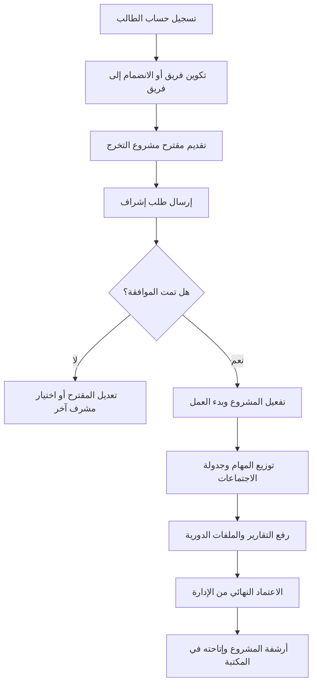
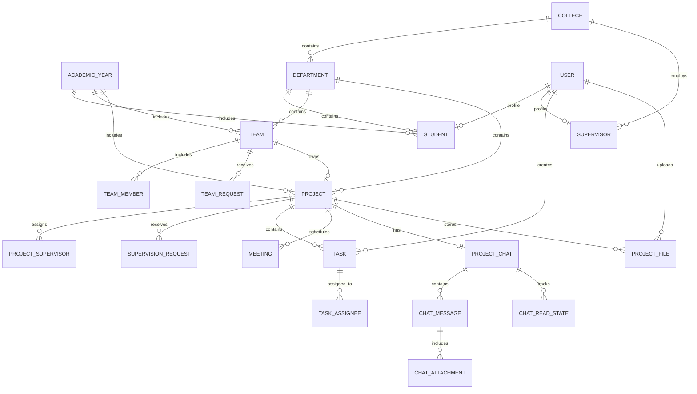

# 🎓 نظام إدارة مشاريع التخرج (GPMS)

  
  
  
  
  

## ✨ نظرة عامة عن النظام 

**GPMS** منصة رقمية متكاملة لإدارة مشاريع التخرج داخل الكليات والجامعات، وتربط بين الطالب، والمشرف الأكاديمي، وإدارة الجامعة ضمن دورة عمل موحدة وواضحة تشمل:

- تقديم واعتماد المقترحات
- تنظيم فرق المشاريع
- متابعة المهام والاجتماعات
- إدارة الملفات والإصدارات
- التواصل الفوري والتوثيق الأكاديمي

---

## 📌 الفهرس

- [نظرة عامة على مكونات النظام](#-نظرة-عامة-على-مكونات-النظام)
- [الميزات الأساسية حسب الأدوار](#-الميزات-الأساسية-حسب-الأدوار)
- [البنية التقنية](#-البنية-التقنية)
- [مخططات Mermaid](#-مخططات-mermaid)
- [الترخيص](#-الترخيص)

---

## 🔍  مكونات النظام

يتكون النظام من ثلاثة مكونات مترابطة:

| المكوّن | الدور |
| --- | --- |
| **لوحة الإدارة** | إدارة الكليات والأقسام والسنوات الأكاديمية والمشاريع والصلاحيات والتقارير. |
| **تطبيق الجوال** | دعم الطالب والمشرف في متابعة المهام والاجتماعات والملفات والتواصل اليومي. |
| **واجهة REST API** | وسيط آمن بين الواجهة الخلفية وتطبيق الجوال باستخدام Laravel Sanctum. |

---

## 🌟 الميزات الأساسية حسب الأدوار

### 👤 الطالب (قائد الفريق / عضو الفريق)

- إنشاء فريق جديد أو الانضمام إلى فريق قائم.
- تقديم مقترح مشروع التخرج وطلب الإشراف الأكاديمي.
- متابعة المهام وتحديث حالاتها حتى الإغلاق.
- رفع تقارير وملفات المشروع مع تتبع الإصدارات.
- التواصل الفوري داخل المشروع مع دعم المرفقات والإشعارات.
- الاستفادة من مكتبة المشاريع المؤرشفة.

### 👨‍🏫 المشرف الأكاديمي

- مراجعة طلبات الإشراف والقبول أو الرفض مع المبررات.
- متابعة تقدم الفرق والمشاريع المرتبطة به.
- تنظيم الاجتماعات حضوريًا أو عبر روابط إلكترونية.
- إدارة المهام وتوزيعها على أعضاء الفرق.

### 🛡️ إدارة الجامعة والكليات

- ضبط الهيكل الأكاديمي (الكليات، الأقسام، السنوات).
- تفعيل/أرشفة السنوات الدراسية ومشاريعها.
- مراقبة المؤشرات والتقارير والإحصائيات التشغيلية.
- إدارة الأدوار والصلاحيات عبر Spatie وFilament Shield.

---

## 💻 البنية التقنية

### Backend & Admin Panel

- **Laravel 12.x** مع **PHP 8.2+**
- **Filament v5** مبني على **Livewire v4**
- **Laravel Sanctum** للمصادقة وتأمين الواجهات
- **Spatie Laravel Permission** + **Filament Shield** لإدارة الصلاحيات
- **Laravel Reverb** أو **Pusher** للبث اللحظي

### Mobile App

- **Flutter** (SDK `^3.38`)
- **Riverpod** لإدارة الحالة
- **Dio** للاتصال بالشبكة وإدارة التوكن
- **Hive** و **Flutter Secure Storage** للتخزين المحلي

### Database & Storage

- **MySQL 8+** مع العلاقات وSoft Deletes
- إدارة ملفات المشروع (PDF/ZIP/DOCX) مع تتبع النسخ وصلاحيات الوصول

---

## 📐 بعض مخططات النظام

### 1) دورة حياة المشروع

### 2) العلاقات الكيانية (ERD)

---

## 📄 الترخيص

هذا المشروع مرخص بموجب [MIT](LICENSE).

