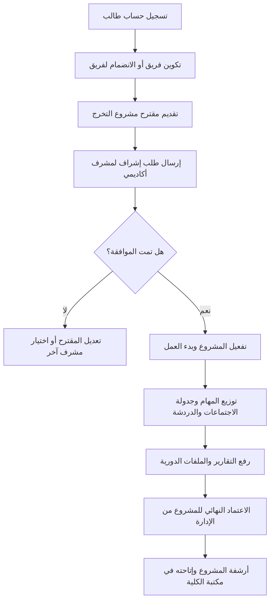
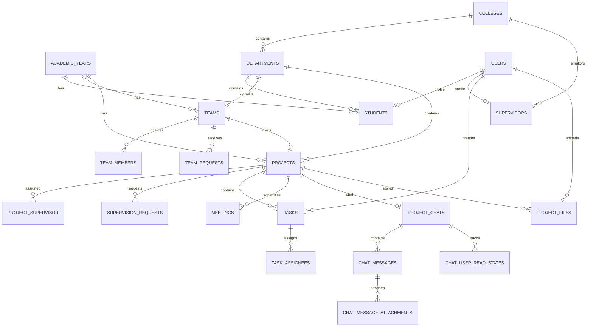

# 🎓 نظام إدارة مشاريع التخرج (GPMS)
## Graduation Project Management System

نظام متكامل لأتمتة وتنظيم عملية إدارة مشاريع التخرج في الكليات والجامعات، يربط الطلاب والمشرفين الأكاديميين وإدارة الكلية في منصة واحدة لتسهيل متابعة وتوثيق المشاريع.

---

## 🔍 نظرة عامة على النظام
يتكون نظام **GPMS** من ثلاثة أجزاء رئيسية متكاملة:
* **لوحة تحكم إدارية (Web Admin Panel):** مبنية باستخدام Laravel 12 و Filament v5 مخصصة لإدارة الكليات، الأقسام، السنوات الدراسية، توزيع المشرفين واعتماد المشاريع.
* **تطبيق موبايل (Mobile Application):** مبني باستخدام Flutter للطلاب والمشرفين لمتابعة المهام، جدولة الاجتماعات، رفع الملفات، والمحادثات اللحظية.
* **واجهة برمجية (REST API):** مبنية باستخدام Laravel Sanctum لتأمين وتسهيل نقل البيانات بين التطبيق والخادم الخلفي.

---

## 📌 الفهرس
1. [الميزات الأساسية لكل دور (Core Features)](#-الميزات-الأساسية-لكل-دور-core-features)
2. [البنية التقنية (Tech Stack)](#-البنية-التقنية-tech-stack)
3. [مخطط النظام (System Architecture)](#-مخطط-النظام-system-architecture)

---

## 🌟 الميزات الأساسية لكل دور (Core Features)

### 👤 الطالب (قائد وعضو الفريق)
* **إدارة الفرق:** إمكانية إنشاء فريق (ليصبح الطالب قائد الفريق) أو إرسال طلب انضمام لفرق قائمة وتلقي الدعوات.
* **تقديم المشاريع:** تقديم مقترحات المشاريع (العنوان، الوصف، والمجال) وطلب الإشراف من الأكاديميين المتاحين.
* **إدارة المهام:** متابعة وتعديل حالة المهام الشخصية المسندة إليه من قائد الفريق أو المشرف (Pending -> Completed).
* **رفع التقارير:** رفع ملفات المشروع (PDF, ZIP) وحفظ الإصدارات وتحديد الملف النهائي.
* **التواصل اللحظي:** الدردشة المباشرة داخل مجموعة المشروع مع إرسال المرفقات واستلام إشعارات بالاجتماعات والمهام الجديدة.
* **مكتبة المشاريع:** البحث وتصفح أرشيف مشاريع التخرج السابقة للاستفادة منها.

### 👨‍🏫 المشرف الأكاديمي
* **طلبات الإشراف:** مراجعة طلبات الإشراف الواردة من الفرق وقبولها أو رفضها مع كتابة سبب الرفض.
* **متابعة المشاريع:** لوحة تحكم لمراقبة أداء الطلاب وحالة تقدم المهام لكل مشروع يشرف عليه.
* **جدولة الاجتماعات:** إمكانية إنشاء وجدولة اجتماعات مع الطلاب وتحديد وقتها ومكانها (حضوري أو رابط إلكتروني) وتحديث حالتها.
* **الدردشة والمهام:** التفاعل الفوري في دردشة المشاريع وإسناد وتعديل مهام الطلاب.

### 🛡️ إدارة الجامعة والكليات (الأدمن)
* **التهيئة الأساسية:** إدارة الكليات، الأقسام، القيود الأكاديمية (الحد الأدنى والأقصى للطلاب في كل فريق).
* **إدارة السنوات:** تفعيل وإدارة السنوات الدراسية وأرشفة المشاريع السابقة تلقائياً عند انتهاء السنة الحالية.
* **تقارير وإحصائيات:** لوحة تحكم Filament متقدمة توفر رسوماً بيانية لمعدلات الإنجاز وتوزيع نصاب المشرفين والطلاب.
* **التحكم بالصلاحيات:** إدارة أدوار المستخدمين وتوزيع الصلاحيات بالاعتماد على حزمة Spatie.

---

## 💻 البنية التقنية (Tech Stack)

### الخلفية ولوحة التحكم (Backend & Admin Panel)
* **الإطار الأساسي:** [Laravel 12.x](https://laravel.com) (PHP 8.2+)
* **لوحة التحكم:** [Filament v5](https://filamentphp.com) (مبنية على Livewire v4)
* **المصادقة والتأمين:** [Laravel Sanctum](https://laravel.com/docs/12.x/sanctum) لتأمين واجهات الـ API.
* **الصلاحيات والأدوار:** [Spatie Laravel Permission](https://spatie.be/docs/laravel-permission) مع حماية مخصصة للوحة التحكم عبر [Filament Shield](https://github.com/bezhanSalleh/filament-shield).
* **البث اللحظي (Realtime):** [Laravel Reverb](https://laravel.com/docs/12.x/reverb) / Pusher Channels لإدارة المحادثات اللحظية والإشعارات الفورية.

### تطبيق الجوال (Mobile Frontend)
* **إطار العمل:** [Flutter](https://flutter.dev) (متوافق مع SDK ^3.38)
* **إدارة الحالة:** [Riverpod](https://riverpod.dev)
* **الاتصال بالشبكة:** [Dio](https://pub.dev/packages/dio) مع interceptors للتعامل مع الـ Token.
* **التخزين المحلي:** [Hive](https://pub.dev/packages/hive) لتخزين البيانات محلياً والدردشة غير المتصلة و [Flutter Secure Storage](https://pub.dev/packages/flutter_secure_storage) لحفظ الجلسات وتوكن المصادقة.
* **المصادقة الحيوية:** البصمة والتعرف على الوجه لتسجيل دخول سريع وآمن.

### قاعدة البيانات والتخزين (Database & Storage)
* **قاعدة البيانات:** MySQL 8.0+ مع دعم العلاقات والتراجع اللين (Soft Deletes).
* **التخزين:** دعم رفع الملفات (PDF, ZIP, DOCX) مع تتبع الإصدارات وتحديد صلاحيات الرؤية.

---

## 📐 مخطط النظام (System Architecture)

### 1. مخطط التدفق ودورة حياة المشروع

### 2. العلاقات الكيانية (Entity Relationship Diagram - ERD)
يقدم النظام بنية بيانات مترابطة ومنظمة لربط كافة العمليات الأكاديمية:

---
## 📄 الترخيص
هذا المشروع مرخص بموجب رخصة [MIT](LICENSE). جميع الحقوق محفوظة لفريق التطوير(Mubarak Saeed).
